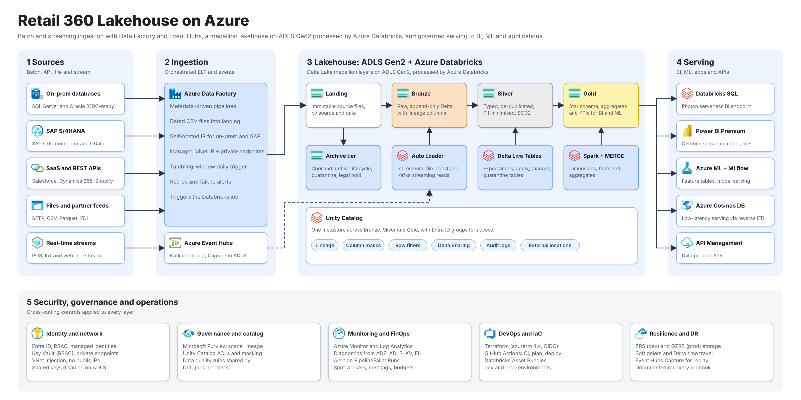

<div align="center">

# Retail 360 Lakehouse on Azure

**A production-style data engineering platform: Azure Data Factory and Event Hubs ingest into an ADLS Gen2 medallion lakehouse, transformed by Azure Databricks (Delta Live Tables, Unity Catalog) and delivered with Terraform and GitHub Actions.**

[](https://github.com/soumikbelel3-commits/azure-lakehouse-retail360/actions/workflows/ci.yml)
[](LICENSE)




[Interactive Miro board](https://miro.com/app/board/uXjVEVvzlZE=/) · [Architecture](docs/architecture.md) · [Data model](docs/data-model.md) · [Deployment](docs/deployment.md) · [Runbook](docs/runbook.md)

</div>

---

## Table of contents

- [What this project shows](#what-this-project-shows)
- [Architecture](#architecture)
- [Tech stack](#tech-stack)
- [Repository layout](#repository-layout)
- [Quick start (no cloud needed)](#quick-start-no-cloud-needed)
- [Deploying to Azure](#deploying-to-azure)
- [CI/CD](#cicd)
- [Data quality and governance](#data-quality-and-governance)
- [Project status](#project-status)
- [Roadmap](#roadmap)
- [Contributing and license](#contributing-and-license)

## What this project shows

A fictional retailer, **Retail 360**, needs one governed view of customers, products, stores, orders
and live point-of-sale activity. This repository contains everything to build it:

- **Metadata-driven ingestion**: one parameterised Data Factory pipeline copies any ERP table to the landing zone, driven by a config file and a daily tumbling-window trigger.
- **Batch and streaming**: Auto Loader for files, Structured Streaming from the Event Hubs Kafka endpoint, with Event Hubs Capture archiving raw events for replay.
- **Medallion lakehouse on Delta**: append-only Bronze, typed and de-duplicated Silver (SCD2 customers), and a Gold star schema with aggregates.
- **Quality you can measure**: blocking and warning rules shared by Delta Live Tables, a DQ gate job and the unit tests; rejected rows go to quarantine tables.
- **Secure by default**: managed identities, OIDC for CI, private endpoints, VNet-injected Databricks, no storage keys, masked PII.
- **Everything as code**: Terraform modules, a Databricks Asset Bundle, Data Factory JSON, Unity Catalog SQL and GitHub Actions workflows.

## Architecture

The diagram above is also available as an editable [Miro board](https://miro.com/app/board/uXjVEVvzlZE=/)
(shared by invitation) and a vector [SVG](docs/images/architecture.svg).

```text
ERP SQL Server --ADF (self-hosted IR)--> landing --Auto Loader--> bronze --DLT--> silver --Spark--> gold --> Databricks SQL / Power BI / ML / APIs
POS terminals ---Event Hubs (Kafka, Capture to ADLS)--------------^
                      Unity Catalog, Key Vault, Purview, Azure Monitor, Terraform and GitHub Actions across every layer
```

Details, design principles and a step-by-step data flow are in [docs/architecture.md](docs/architecture.md).
Architecture decisions are recorded in [docs/adr](docs/adr).

## Tech stack

| Concern | Technology |
| --- | --- |
| Orchestration | Azure Data Factory (managed VNet IR, self-hosted IR, tumbling-window trigger) |
| Streaming | Azure Event Hubs (Kafka endpoint, Capture) |
| Storage | ADLS Gen2 with hierarchical namespace, Delta Lake |
| Processing | Azure Databricks Premium, PySpark 4, Delta Live Tables, Auto Loader |
| Governance | Unity Catalog (external locations, grants, column masks), Microsoft Purview |
| Security | Entra ID, managed identities, Key Vault, private endpoints |
| Observability | Azure Monitor, Log Analytics, metric alerts |
| IaC and CI/CD | Terraform (azurerm 5.x), Databricks Asset Bundles, GitHub Actions with OIDC |
| Quality | pytest, ruff, shared data quality rules |

## Repository layout

```text
.
├── src/retail360/          Transformation library (config, schemas, bronze, silver, gold, quality, jobs)
├── pipelines/              Delta Live Tables pipeline for Bronze -> Silver
├── tests/                  Unit tests that run the real logic on a local Spark session
├── data/sample/            Deterministic, deliberately dirty sample data (ERP CSV and POS JSON)
├── databricks.yml          Databricks Asset Bundle (dev and prod targets)
├── databricks/resources/   Job and pipeline definitions
├── adf/                    Data Factory linked services, datasets, pipelines, trigger and config
├── infra/terraform/        Azure infrastructure modules and environments
├── sql/                    Unity Catalog setup and PII governance
├── scripts/                Sample data generator, ADF deploy, SQL render, diagram renderer
├── docs/                   Architecture, data model, security, runbook, cost, deployment, ADRs
└── .github/                CI and deploy workflows, issue and PR templates, Dependabot
```

## Quick start (no cloud needed)

The transformation logic is plain PySpark, so you can run all of it locally. You need Python 3.10+
and Java 17+.

```bash
git clone https://github.com/soumikbelel3-commits/azure-lakehouse-retail360.git
cd azure-lakehouse-retail360
python -m venv .venv && source .venv/bin/activate
pip install -e ".[dev]"

make check          # ruff, unit tests with coverage, JSON/YAML and ADF reference validation
```

The tests load the sample files in `data/sample` through the same cleaning, quality and Gold code
that runs on Databricks. For example, the dirty sample customers produce 60 valid rows, 2
quarantined rows and 3 invalid emails; 240 valid orders and 1 quarantined; and a `fact_sales`
of 595 completed order lines.

## Deploying to Azure

Full instructions, including the one-time manual steps, are in [docs/deployment.md](docs/deployment.md).
In short:

```bash
# 1. Infrastructure
cd infra/terraform
terraform init -backend-config=environments/backend-dev.hcl
terraform apply -var-file=environments/dev.tfvars -var "subscription_id=$ARM_SUBSCRIPTION_ID"

# 2. Unity Catalog (storage credential, then SQL)
scripts/render_sql.sh sql/01_unity_catalog_foundation.sql retail360_dev <storage-account>

# 3. Databricks jobs, pipeline and wheel
databricks bundle deploy -t dev

# 4. Data Factory
scripts/deploy_adf.sh
```

## CI/CD

| Workflow | Trigger | What it does |
| --- | --- | --- |
| `ci.yml` | Pull request, push to `main` | Ruff lint and format, unit tests with coverage, JSON/YAML/ADF validation, shellcheck, `terraform fmt` and `validate`, gitleaks secret scan |
| `deploy-infra.yml` | Manual | Terraform plan, then optional apply behind the environment's approval gate (Azure OIDC, remote state) |
| `deploy-databricks.yml` | Push to `main` (dev), manual (prod) | Builds the wheel, validates and deploys the bundle |
| `deploy-adf.yml` | Push to `main` (dev), manual (prod) | Substitutes environment values and deploys Data Factory definitions |

## Data quality and governance

- Rules per entity are defined once in [`quality.py`](src/retail360/quality.py), see the table in [docs/data-model.md](docs/data-model.md#data-quality-rules).
- Blocking rules quarantine rows; warning rules keep them and track pass rates in `gold.dq_results`.
- Direct identifiers are masked with Unity Catalog column masks; email is hashed and phone masked before Silver. See [docs/security.md](docs/security.md).

## Project status

This is a **reference implementation**. Be clear about what has and has not been proven:

| Area | Status |
| --- | --- |
| Python library, DLT pipeline definition, sample data | Implemented, unit-tested locally with PySpark (25 tests) |
| Terraform, bundle, ADF JSON, SQL, workflows | Complete and syntax-checked; not applied to a live subscription. Expect to adjust names, network ranges and groups, and run `terraform fmt` and `plan` before the first deploy |
| Purview, Power BI, Azure ML, Cosmos DB, API Management | Architectural targets shown in the diagram; no code here yet |

## Roadmap

- [ ] Power BI semantic model and deployment pipeline over the Gold layer
- [ ] Purview scan configuration and lineage integration as code
- [ ] CDC ingestion (SAP CDC connector, Debezium) in place of watermark queries
- [ ] Customer-managed keys and Front-end Private Link for the production profile
- [ ] Feature tables and an MLflow demand-forecasting pipeline
- [ ] Data contracts with automated checks in CI

## Contributing and license

Contributions are welcome, see [CONTRIBUTING.md](CONTRIBUTING.md) and the [code of conduct](CODE_OF_CONDUCT.md).
Report vulnerabilities as described in [SECURITY.md](SECURITY.md).

Released under the [MIT License](LICENSE). Azure icons in `docs/images/icons` are the official
Microsoft Azure architecture icons, used here to illustrate Azure services; they remain the property
of Microsoft.
