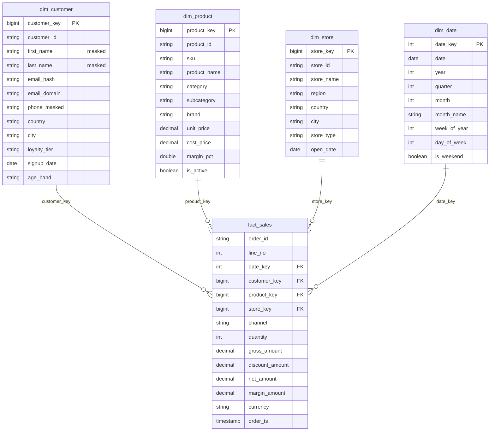

# Data model

## Layers

| Layer | Schema | Tables | Notes |
| --- | --- | --- | --- |
| Bronze | `bronze` | `customers`, `products`, `stores`, `orders`, `order_items`, `pos_events` | All columns are strings plus `_ingested_at`, `_source_file`, `_batch_id`, `_rescued_data` |
| Silver | `silver` | the same six entities, plus `<entity>_quarantine` | Typed, de-duplicated; customers keep history (`__START_AT`, `__END_AT`) |
| Gold | `gold` | `dim_customer`, `dim_product`, `dim_store`, `dim_date`, `fact_sales`, `agg_daily_sales`, `agg_hourly_pos`, `dq_results` | Star schema for BI |

## Gold star schema

- **Grain of `fact_sales`:** one row per completed order line (`order_id`, `line_no`).
- **Surrogate keys:** `xxhash64` of the business key, so keys are deterministic and re-runnable
  without a sequence table.
- **`agg_daily_sales`:** `date_key`, `store_key`, `category` grain with `net_revenue`, `margin`,
  `units_sold`, `orders`, `avg_order_value`.
- **`agg_hourly_pos`:** `store_id`, `event_hour` with `units_sold`, `units_returned`, `net_units`,
  `events`; this is the near-real-time view fed by the stream.

## Data quality rules

Rules live in `src/retail360/quality.py` and are applied identically by the DLT pipeline
(`expect_all_or_drop` / `expect_all`), the DQ job and the tests.

| Entity | Blocking rules (row is quarantined) | Warning rules (row is kept, rate is tracked) |
| --- | --- | --- |
| customers | `customer_id` present | email format valid, signup date present |
| products | `product_id` present, `unit_price >= 0` | price covers cost |
| stores | `store_id` present | country is ISO-2 |
| orders | order, customer and timestamp present; status known | currency is ISO-3 |
| order_items | order and product present; quantity > 0; price >= 0 | discount between 0 and 100 |
| pos_events | event id, store and timestamp present; event type known; quantity > 0 | none |

## PII handling

Clear-text email and phone never reach Silver: the email is replaced by a SHA-256 hash plus its
domain, and the phone is masked. First and last name remain direct identifiers and are protected by
a Unity Catalog column mask (see `sql/02_pii_governance.sql`).
